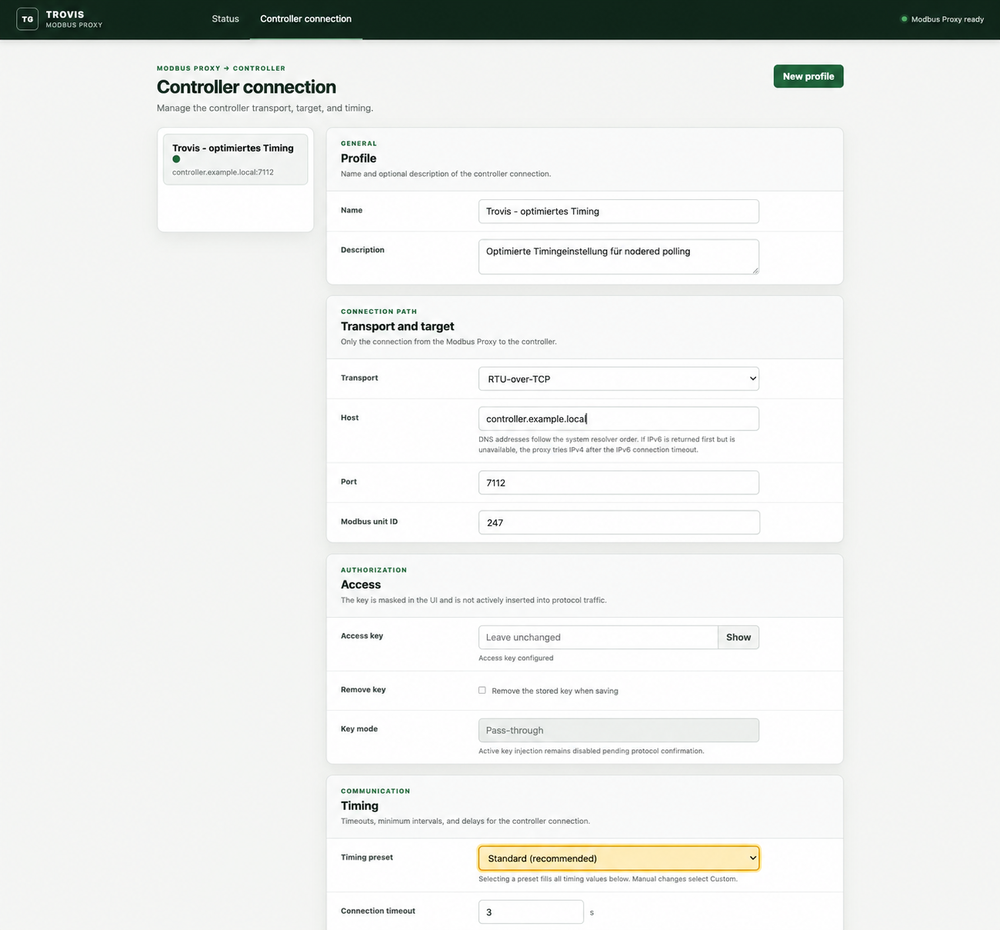

# TROVIS Modbus Proxy für TROVIS-VIEW und SAMSON-Regler

[English](README.md) | Deutsch

> **Neu in 1.2.0:** Die Reglerweiterleitung lässt sich über die Weboberfläche sicher pausieren.
> Zusätzlich stehen die Timing-Voreinstellungen Schnell, Standard, Zuverlässig und Benutzerdefiniert
> sowie eine verbesserte Verarbeitung von DNS-Namen für Reglerverbindungen bereit. Einzelheiten
> enthält das [Changelog](CHANGELOG.md#120---2026-11-21).

Der **TROVIS Modbus Proxy** ist ein selbst gehosteter Modbus-Proxy für eine zuverlässige
Kommunikation zwischen **SAMSON TROVIS-VIEW** und TROVIS-Heizungsreglern, einschließlich der
Baureihe **SAMSON TROVIS 5573-1xxx**. Er stellt TROVIS-VIEW einen stabilen Modbus-TCP-Endpunkt
bereit und verbindet sich über Modbus TCP, RTU-over-TCP oder Serial RTU mit dem Regler.

```text
TROVIS-VIEW → Modbus TCP → TROVIS Modbus Proxy → Modbus TCP / RTU-over-TCP / Serial RTU → Regler
```

Der Modbus Proxy leitet Modbus-PDUs unverändert weiter und verwendet keine regler- oder
firmwarespezifische Adressübersetzung. Der Code für TROVIS 5573-1 FW 3.09 in
`src/trovis_manager/` bleibt eine getrennte, schreibgeschützte Integrations- und
Forschungsumgebung; er ist nicht Bestandteil des Modbus-Proxy-Kerns.

## Hauptvorteile

- Zuverlässiger TROVIS-VIEW-Zugriff über einen stabilen Modbus-TCP-Listener auf Port `7112`.
- Stabile Firmware-Updates des Reglers über TROVIS-VIEW mit derselben zuverlässigen
  Proxy-Verbindung.
- Reglerverbindungen über Modbus TCP, transparentes RTU-over-TCP oder Serial RTU.
- Docker-Compose-Bereitstellung für Linux-Server und NAS-Systeme wie Synology.
- Dauerhaft gespeicherte Reglerprofile mit einer responsiven browserbasierten
  Administrationsoberfläche.
- Koordinierung mehrerer Clients, sichere Wiederholungen von Lesezugriffen, geschützte
  Schreibvorgänge, zeitliche Steuerung und proaktive Neuverbindungen.
- Transparenter Betrieb mit seriellen USR-Ethernet-Adaptern im Protokollmodus `None`.
- Reglerneutraler Modbus-Proxy-Kern ohne fest hinterlegte Registertabellen oder synthetische Werte.

## Sicherheitshinweis – OpenSSL-Befunde

Docker Scout meldet derzeit sechs Befunde, die aus dem OpenSSL-3.5.7-Laufzeitpaket von Debian 13
stammen. Sie haben ihren Ursprung nicht im Quellcode des TROVIS Modbus Proxy.

Der Proxy verwendet unverschlüsseltes Modbus TCP und serielle Kommunikation. Die betroffenen
Funktionen für QUIC, AES-GCM-SIV, CMS-Verschlüsselung und spezielle PEM-Stack-Verarbeitung werden
nicht direkt verwendet. Die aktuelle Gefährdung erscheint deshalb begrenzt. Die Befunde bleiben
dennoch sichtbar, bis korrigierte Pakete verfügbar sind.

OpenSSL hat korrigierte Upstream-Versionen für den **1. Dezember 2026** angekündigt. Sobald auch
ein entsprechend korrigiertes Debian-Paket verfügbar ist, wird das Container-Image neu erstellt,
für AMD64 und ARM64 getestet, erneut geprüft und als Wartungsversion veröffentlicht.

Durch diesen Hinweis wird keine Schwachstelle unterdrückt oder als behoben gekennzeichnet.

Weitere Informationen:

- https://openssl-library.org/news/secadv/20261110.txt
- https://openssl-library.org/news/secadv/20261117.txt

## Warum dieser Modbus Proxy?

Ich verwende TROVIS-VIEW mit dem Modbus-Protokoll, um die Konfiguration meines Heizungsreglers
SAMSON TROVIS 5573-1xxx zu verwalten. Der `ModbusTCP`-Modus meines Modbus-Adapters
USR-TCP232-E2 stellte jedoch keine zuverlässige Verbindung bereit. Die Kommunikation war instabil,
wodurch Lese- und Schreibvorgänge fehlschlugen. Ähnliche Probleme können auch mit anderen
seriellen Ethernet-Adaptern auftreten, die selbst eine Modbus-TCP-zu-RTU-Konvertierung ausführen.

Die zuverlässige Konfiguration besteht darin, den USR-Adapter als `TCP Server` mit dem
Protokollmodus `None` einzurichten und anschließend im Reglerprofil des Modbus Proxy
`RTU-over-TCP` auszuwählen. Dadurch bleibt der Adapter transparent, während der Modbus Proxy die
Modbus-TCP-zu-RTU-Rahmung übernimmt.

Dieses Interoperabilitätsproblem war der ursprüngliche Anlass für die Entwicklung des TROVIS
Modbus Proxy. Inzwischen hat sich das Projekt zu einer allgemeineren Kommunikationsschicht mit
weiteren Stärken entwickelt:

- **Koordinierter Mehr-Client-Zugriff:** TROVIS-VIEW, Node-RED, TROVIS 55 Pro und weitere
  Modbus-TCP-Clients können über einen Modbus Proxy auf denselben Regler zugreifen. Die
  Anfragesequenzen eines Clients werden in eine Warteschlange gestellt und zusammengehalten,
  damit konkurrierende Anwendungen keine fehlerhaften Reglerauslesungen verursachen.
- **Stabile Firmware-Updates:** Wenn der Adapter im transparenten Modus `None` arbeitet und der
  Modbus Proxy `RTU-over-TCP` verwendet, transportiert der Adapter die seriellen Modbus-RTU-Rahmen,
  ohne sie zu decodieren oder umzuschreiben. Die Nutzdaten der Modbus-PDUs bleiben unverändert.
  Dadurch entfällt die Protokollkonvertierung im Adapter und TROVIS-VIEW erhält einen stabilen
  Übertragungsweg für Firmware-Updates.
- **Transparente Protokollverarbeitung:** Modbus-Funktionscodes, Adressen und Werte werden
  unverändert weitergeleitet. Der Modbus Proxy ist weder von einer reglerspezifischen
  Registertabelle noch von einer synthetischen Adressübersetzung abhängig.
- **Flexible Reglerverbindungen:** Für die Verbindung zum Regler stehen Modbus TCP, transparentes
  RTU-over-TCP und Serial RTU zur Verfügung.
- **Zuverlässiges Verbindungsmanagement:** Einstellbare Anfrageabstände, Zeitüberschreitungen,
  sichere Wiederholungen von Lesezugriffen und proaktive Neuverbindungen stabilisieren die
  Kommunikation mit Reglern und Ethernet-Adaptern.
- **Kontrollierte Wartungspausen:** Die Weiterleitung kann angehalten werden, ohne den Dienst zu
  stoppen. Neue und bereits wartende Anfragen werden mit der Modbus-Ausnahme `0x0B` abgewiesen;
  aktive Anfragen werden sicher beendet und nichts wird zur späteren Ausführung gespeichert.
- **Praktische Timing-Profile:** Schnell, Standard und Zuverlässig decken typische Betriebsfälle
  ab; mit Benutzerdefiniert bleiben alle Timingwerte einzeln einstellbar.
- **Geschützte Schreibvorgänge:** Schreibvorgänge werden nach einem uneindeutigen Ergebnis niemals
  wiederholt. Dadurch sinkt das Risiko unbeabsichtigter Konfigurationsänderungen.
- **Einfacher selbst gehosteter Betrieb:** Docker Compose, dauerhafte Konfiguration und eine
  browserbasierte Administrationsoberfläche machen den Modbus Proxy für NAS-Systeme und andere
  dauerhaft laufende Linux-Rechner geeignet.
- **Betriebstransparenz:** Die Statusoberfläche zeigt verbundene Clients, wartende Anfragen,
  Wiederholungen, Zeitüberschreitungen, Neuverbindungen und die aktive Reglerverbindung.

### Status des Modbus Proxy


*Statusübersicht für den TROVIS-VIEW-Listener und die aktive Verbindung zum Regler.*

### Reglerverbindung



*Reglerprofil mit RTU-over-TCP, Ziel, Modbus Unit ID und hervorgehobener Auswahl für die
Timing-Voreinstellung.*

*Private Netzwerkadressen sind in beiden Oberflächenbeispielen anonymisiert.*


*Beispiel für den USR-Adapter: Socket A verwendet `TCP Server`, Protokollmodus `None` und den
lokalen Port `7112`.*

## Schnellstart mit Docker oder Python

### Docker Compose mit dem neuesten Docker-Hub-Image (empfohlen)

Das öffentliche Multi-Plattform-Image unterstützt Linux AMD64 und ARM64. Docker wählt automatisch
das passende Image aus.

```bash
mkdir -p data
sudo chown -R 1000:1000 data
docker compose pull
docker compose up -d
```

Öffnen Sie `http://localhost:8083/`. Die Standarddatei `compose.yaml` lädt
`docker.io/macsobeck/trovis-proxy:latest`; sie erstellt das `Dockerfile` des Repositorys nicht neu
und benötigt keine Anmeldung bei einer Registry. Der Container läuft mit UID/GID `1000:1000` und
veröffentlicht den TROVIS-VIEW-Listener auf Port `7112`.

### Native Python-Installation

Python 3.12 oder neuer wird benötigt.

```bash
python3.12 -m venv .venv
source .venv/bin/activate
python -m pip install -e '.[dev,serial]'
mkdir -p data
trovis-gateway --listen-host 0.0.0.0 --listen-port 7112 \
  --admin-host 127.0.0.1 --admin-port 8080 \
  --config-path ./data/config.json
```

Öffnen Sie bei einer nativen Installation `http://127.0.0.1:8080/`.

Erstellen Sie ein Reglerprofil, testen Sie dessen Transportverbindung und aktivieren Sie es. Der
Verbindungstest öffnet ausschließlich den konfigurierten Transport und sendet keine erfundene
Modbus-Registeranfrage. Listener-Adresse und -Port sind Infrastruktureinstellungen aus
Umgebungsvariablen oder CLI-Argumenten und keine Felder des Reglerprofils.

Profildaten bleiben im Host-Verzeichnis `./data` gespeichert und erscheinen im Docker-Container
als `/data/config.json` mit dem Modus `0600`. Ein gespeicherter Zugriffsschlüssel wird in API und
Oberfläche maskiert. Er wird weder protokolliert noch als Metrik ausgegeben oder in den
Protokollverkehr eingefügt.

## Installationsanleitungen

Wählen Sie die [deutsche Schritt-für-Schritt-Anleitung](docs/gateway/installation.de.md) oder die
[englische Installationsanleitung](docs/gateway/installation.md). Sie behandeln:

- Voraussetzungen für Docker und Docker Compose;
- Installation auf einem Synology NAS, Bind-Mounts, UID/GID-Rechte und dauerhafte Speicherung;
- Reglerprofile für Modbus TCP, RTU-over-TCP und Serial RTU;
- Einstellungen für serielle USR-Ethernet-Adapter;
- TROVIS-VIEW-Netzwerkkonfiguration;
- Updates, Sicherungen, Diagnose und Fehlerbehebung.

## Sicherheitsmodell

- Nachgelagerte Unit IDs werden gespeichert und in Antworten wiederhergestellt; auf der
  Reglerseite wird die Unit ID des aktiven Profils verwendet.
- Lesezugriffe mit FC01–04 dürfen nach einem eindeutigen Transportfehler wiederholt werden.
- Schreibzugriffe mit FC05/06/0F/10 werden nach einem uneindeutigen Ergebnis niemals wiederholt.
- Unbekannte und herstellerspezifische Funktionscodes werden undurchsichtig weitergeleitet und
  bleiben nachvollziehbar.
- Alle Modbus-PDUs, einschließlich FC01-Adressen, werden unverändert weitergeleitet.
- TCP-Verbindungen werden standardmäßig nach 25 Sekunden und damit vor der beobachteten
  30-Sekunden-Sitzungsgrenze des Reglers erneuert. Die Erneuerung erfolgt vor einer Anfrage und
  wiederholt niemals einen uneindeutigen Schreibzugriff.
- Alle Anfragen an einen Regler werden serialisiert und zeitlich gesteuert. Aufeinanderfolgende
  Anfragen eines verbundenen Clients behalten kurzzeitig Vorrang, damit kein anderer Client eine
  Abfragesequenz unterbrechen kann.

Weitere Informationen finden Sie in der englischen Dokumentation zu
[Modbus-Proxy-Architektur](docs/gateway/architecture.md),
[Konfiguration](docs/gateway/configuration.md) und
[Protokollsicherheit](docs/gateway/protocol-safety.md). Release-Änderungen sind im
[Changelog](CHANGELOG.md) dokumentiert.

## Häufig gestellte Fragen

### Ersetzt dieser Modbus Proxy TROVIS-VIEW?

Nein. TROVIS-VIEW bleibt die Konfigurationsanwendung. Der Modbus Proxy stellt einen zuverlässigen
Netzwerkpfad zwischen TROVIS-VIEW und dem Heizungsregler bereit.

### Welche TROVIS-Regler werden unterstützt?

Der Kern des Modbus Proxy ist reglerneutral und leitet Modbus-PDUs transparent weiter. Die
dokumentierte Bereitstellung wurde mit einem Regler SAMSON TROVIS 5573-1xxx validiert. Andere
Regler können verwendet werden, wenn sie eine kompatible Schnittstelle für Modbus TCP,
RTU-over-TCP oder Serial RTU bereitstellen.

### Kann der TROVIS Modbus Proxy auf einem Synology NAS betrieben werden?

Ja. Die Docker-Compose-Konfiguration unterstützt den NAS-Betrieb, UID/GID-Zuordnung, automatische
Neustarts und ein dauerhaft eingebundenes Verzeichnis `./data` für die Reglerprofile.

### Welchen Modus soll ein USR-Ethernet-Adapter verwenden?

Verwenden Sie `TCP Server` mit dem Protokollmodus `None` und wählen Sie anschließend im Profil des
Modbus Proxy `RTU-over-TCP`. Aktivieren Sie für die TROVIS-VIEW-Kommunikation nicht den
Konvertierungsmodus `ModbusTCP` des Adapters.

## Entwicklungsunterstützung

Dieses Repository wird von macsobeck mit Unterstützung von OpenAI Codex für Codeanalyse,
Implementierung, Tests, Dokumentation und Release-Vorbereitung entwickelt und gepflegt. Alle
Änderungen werden vom Repository-Betreiber geprüft und veröffentlicht.

## Entwicklung

```bash
pytest
ruff check .
git diff --check
```

Die Standardtests verwenden ausschließlich lokale simulierte Server und benötigen keine echte
Hardware. Die bisherige Forschungs-CLI bleibt als `trovisctl` verfügbar; ihr Hardware-Ablauf ist
weiterhin schreibgeschützt. Lesen Sie vor einer Verbindung mit einem Regler die englische
Dokumentation zur [Hardwarevalidierung](docs/hardware-validation.md).

## Repository-Struktur

- `src/trovis_gateway/`: allgemeiner Modbus Proxy, Transporte, Konfiguration, API und
  Administrationsoberfläche.
- `src/trovis_manager/`: gerätespezifische schreibgeschützte Integrationsumgebung.
- `tests/gateway/`, `tests/unit/`, `tests/integration/`: automatisierte Testabdeckung.
- `reference/`: unveränderliche Quellartefakte und abgeleitete Forschungsdaten für FW 3.09.
- `docs/`: Architektur, Sicherheitsnachweise und Forschungsergebnisse.
