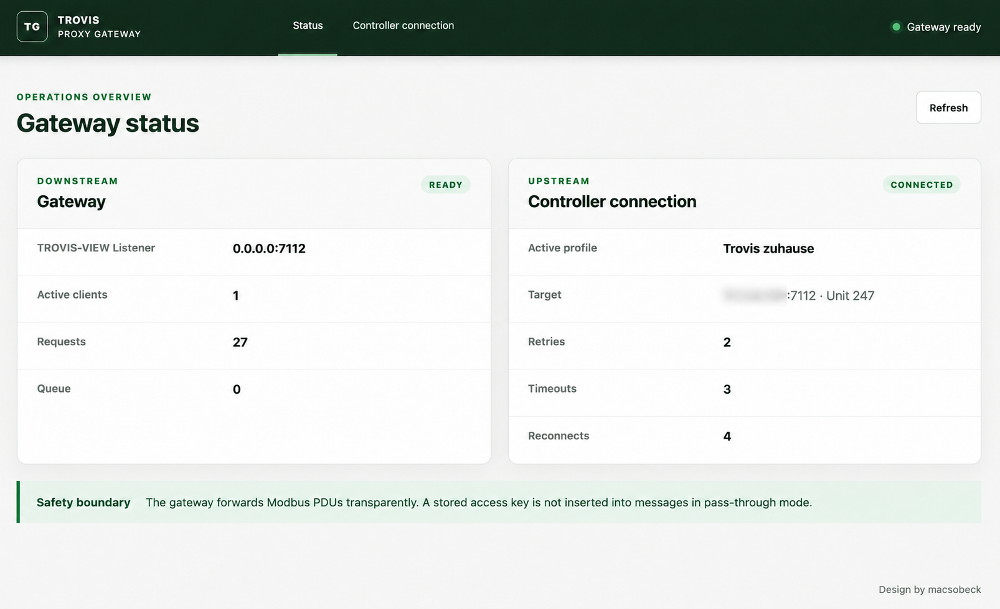
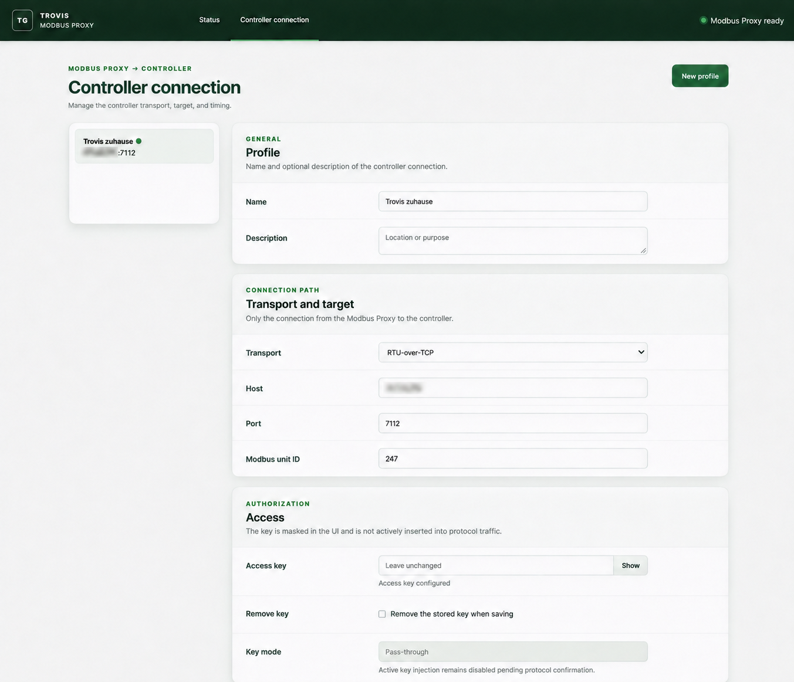
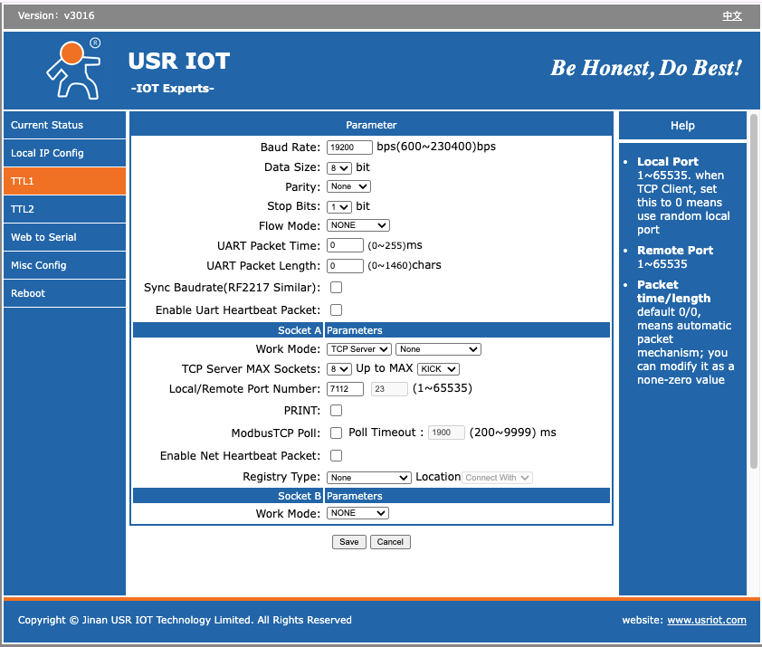

# TROVIS Communication Gateway

This repository contains a generic, locally operated communication gateway:

```text
TROVIS-VIEW → Modbus TCP → Gateway → Modbus TCP / RTU-over-TCP / Serial RTU → controller
```

The proxy forwards Modbus PDUs unchanged and has no controller- or firmware-specific address
translation. The TROVIS 5573-1 FW 3.09 code in `src/trovis_manager/` remains a separate, read-only
integration and research harness; it is not part of the proxy core.

## Interface examples

### Gateway status



*Status overview for the TROVIS-VIEW listener and the active upstream controller connection.*

### Controller connection



*Controller profile using RTU-over-TCP with its target, Modbus unit ID, and access settings.*

*Private network addresses are redacted in both interface examples.*

## Why this proxy

For reliable operation with a USR serial-to-Ethernet adapter, configure Socket A as
`TCP Server` and set its protocol mode to `None`. Do not select `ModbusTCP` in the adapter.
In the proxy controller profile, select `RTU-over-TCP`. This combination keeps the adapter in
transparent mode and lets the proxy handle the Modbus TCP-to-RTU framing. Using the adapter's
`ModbusTCP` mode with TROVIS-VIEW can cause unstable connections and failed reads and writes to
heating controllers such as the SAMSON TROVIS 5573-1xxx series.



*USR adapter example: Socket A uses `TCP Server`, protocol mode `None`, and local port `7112`.*

## Run the gateway

Python 3.12 or newer is required.

```bash
python -m pip install -e '.[dev,serial]'
trovis-gateway --listen-host 0.0.0.0 --listen-port 7112 \
  --admin-host 127.0.0.1 --admin-port 8080 \
  --config-path ./data/config.json
```

Open `http://127.0.0.1:8080`, create a controller profile, test its transport connection,
and activate it. The connection test opens only the configured transport; it sends no
invented Modbus register request. The listener address and port are infrastructure settings
provided by environment variables or CLI arguments—not controller-profile fields.

For Docker:

```bash
cp .env.example .env
docker compose up --build
```

Compose builds the explicitly tagged local image
`trovis-proxy:0.1.0` from the repository's `Dockerfile`. The container defaults
to UID/GID `1000:1000`; both values can be changed in `.env` for NAS bind mounts.
The administration website is published to the LAN on host port `8083`.

Profile data persists in the host directory `./data` and appears as `/data/config.json` in the
container with mode `0600`. A stored access key is masked in the API and UI and is not logged,
exposed as a metric, or injected into protocol traffic.

## Safety model

- Downstream Unit IDs are recorded and restored in responses; the active profile's Unit ID
  is used upstream.
- FC01–04 reads may retry after a clear transport failure.
- FC05/06/0F/10 writes never retry after an ambiguous result.
- Unknown and vendor-specific function codes are forwarded opaquely and are traceable.
- All Modbus PDUs, including FC01 addresses, are forwarded unchanged.
- TCP connections are renewed after 25 seconds by default, before the observed 30-second controller
  session boundary; renewal occurs before a request and never retries an ambiguous write.
- All requests to a controller are serialized and paced.

See [gateway architecture](docs/gateway/architecture.md),
[configuration](docs/gateway/configuration.md), and
[protocol safety](docs/gateway/protocol-safety.md). For a complete deployment,
follow the [step-by-step installation guide](docs/gateway/installation.md).

## Development

```bash
pytest
ruff check .
git diff --check
```

The default suite uses only local fake servers and never requires real hardware. The legacy
research CLI remains available as `trovisctl`; its hardware workflow stays read-only. See
[hardware validation](docs/hardware-validation.md) before connecting it to a controller.

## Repository layout

- `src/trovis_gateway/`: generic proxy, transports, configuration, API, and admin UI.
- `src/trovis_manager/`: device-specific read-only integration harness.
- `tests/gateway/`, `tests/unit/`, `tests/integration/`: automated coverage.
- `reference/`: immutable source artifacts and derived FW 3.09 research data.
- `docs/`: architecture, safety evidence, and research findings.
