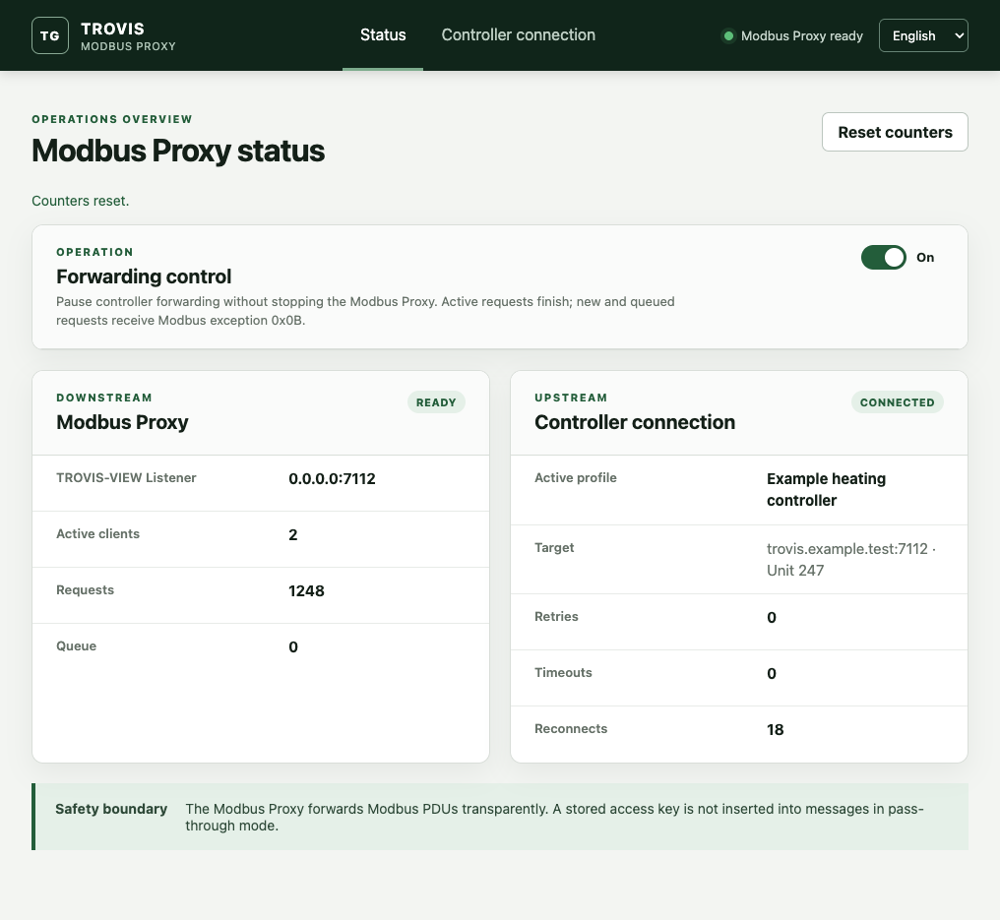
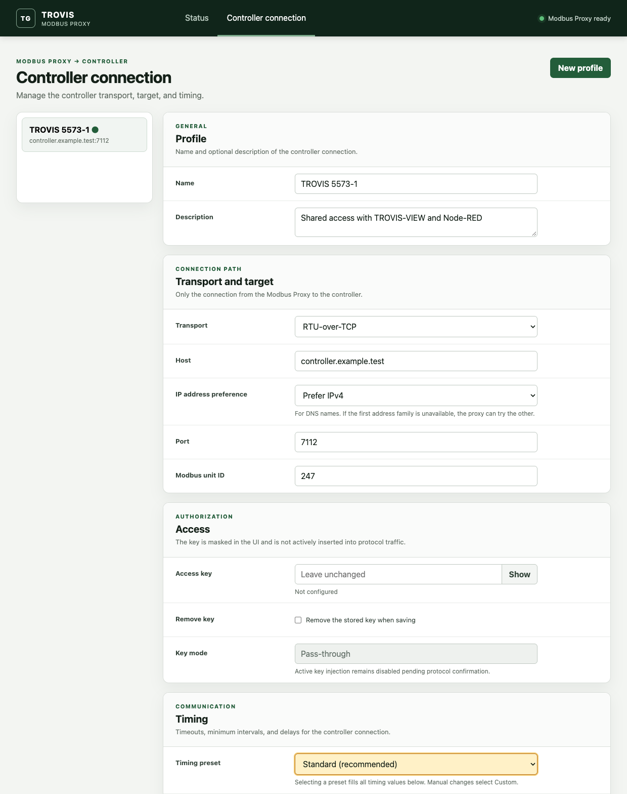
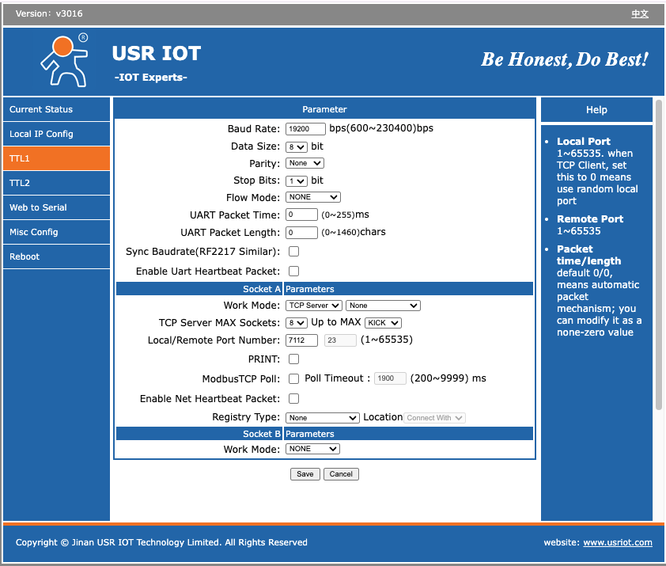

# TROVIS Modbus Proxy for Smart Home Applications accessing SAMSON Controllers

English | [Deutsch](README.de.md)

The TROVIS Modbus Proxy is a self-hosted Modbus Proxy for reliable communication between Smart
Home Applications (like e.g. SAMSON TROVIS-VIEW, Home Assistant, node-red etc.) and TROVIS heating
controllers, including the SAMSON TROVIS 5573-1xxx series. It provides a stable Modbus TCP endpoint
for Smart Home Applications and connects to the controller through Modbus TCP, RTU-over-TCP, or
Serial RTU.

> **New in 1.2.3**
>
> - **Bilingual administration interface.** English is the default. Switch to German in the
>   header. Your browser remembers the choice.
> - **Simplified client scheduling.** Choose multi-client operation with or without TROVIS-VIEW,
>   or set a custom sequence window. Advanced controller timing is configured separately.
>
> See the [changelog](CHANGELOG.md#123---2026-11-25) for details.

```text
Client application → Modbus TCP → TROVIS Modbus Proxy → Modbus TCP / RTU-over-TCP / Serial RTU → controller
```

The Modbus Proxy forwards Modbus PDUs unchanged and has no controller- or firmware-specific
address translation. The TROVIS 5573-1 FW 3.09 code in `src/trovis_manager/` remains a separate,
read-only integration and research harness; it is not part of the Modbus Proxy core.

## Key features

- Stable Modbus TCP access for TROVIS-VIEW, Home Assistant, Node-RED, and other clients on port `7112`.
- Stable controller firmware upgrades through TROVIS-VIEW using the same reliable proxy connection.
- Controller connections via Modbus TCP, transparent RTU-over-TCP, or Serial RTU.
- Docker Compose deployment for Linux servers and NAS systems such as Synology.
- Persistent controller profiles with a responsive browser-based administration interface.
- Multi-client sequence arbitration, safe read retries, protected writes, pacing, and proactive
  reconnects.
- Transparent operation with USR serial-to-Ethernet adapters in protocol mode `None`.
- Controller-neutral Modbus Proxy core without hard-coded register maps or synthetic values.

## Security notice – OpenSSL findings

Docker Scout currently reports six findings inherited from the Debian 13 OpenSSL 3.5.7 runtime
package. They do not originate from the TROVIS Modbus Proxy source code.

The proxy uses plain Modbus TCP and serial communication and does not directly use the affected
QUIC, AES-GCM-SIV, CMS encryption, or special PEM-stack functions. The current exposure therefore
appears limited, but the findings will remain visible until corrected packages are available.

OpenSSL has announced fixed upstream releases for **1 December 2026**. Once the corresponding
corrected Debian package is available, the container will be rebuilt, tested for AMD64 and ARM64,
rescanned, and published as a maintenance release.

No vulnerability has been suppressed or marked as resolved by this notice.

Further information:

- https://openssl-library.org/news/secadv/20261110.txt
- https://openssl-library.org/news/secadv/20261117.txt

## Why this Modbus Proxy

I use TROVIS-VIEW with Modbus protocol to manage the configuration of my SAMSON TROVIS 5573-1xxx
heating controller. However, using my USR-TCP232-E2 modbus adapter's `ModbusTCP` mode did not
provide a reliable connection. It caused unstable communication causing failed reads and writes.
Similar problems may also occur with other serial-to-Ethernet adapters that perform their own
Modbus TCP-to-RTU conversion.

The reliable setup is to configure the USR adapter as a `TCP Server` with its protocol mode set to
`None`, and then select `RTU-over-TCP` in the Modbus Proxy controller profile. This keeps the
adapter transparent and lets the Modbus Proxy handle the Modbus TCP-to-RTU framing.

This interoperability problem was the original motivation for developing the TROVIS Modbus Proxy.
The project has since evolved into a more general communication layer with several additional
strengths:

- **Coordinated multi-client access:** TROVIS-VIEW, Home Assistant, Node-RED, TROVIS 55 Pro, and
  other Modbus TCP clients can access the same controller through one Modbus Proxy. Client request sequences are
  queued and kept together to prevent competing applications from causing failed controller reads.
- **Stable firmware upgrades:** With the adapter in transparent `None` mode and the Modbus Proxy
  using `RTU-over-TCP`, serial Modbus RTU frames are transported without being decoded or rewritten
  by the adapter. Their Modbus PDU payloads remain unchanged, avoiding adapter-side protocol
  conversion and providing a stable path for TROVIS-VIEW firmware upgrades.
- **Transparent protocol handling:** Modbus function codes, addresses, and values are forwarded
  unchanged. The Modbus Proxy does not depend on a controller-specific register map or synthetic
  address translation.
- **Flexible controller connections:** The upstream connection can use Modbus TCP, transparent
  RTU-over-TCP, or Serial RTU.
- **Reliable connection management:** Configurable pacing, timeouts, safe read retries, and
  proactive reconnection help stabilize communication with controllers and Ethernet adapters.
- **Controlled maintenance pauses:** Forwarding can be paused without stopping the service. New
  and already queued requests are rejected with Modbus exception `0x0B`; active requests finish
  safely, and nothing is stored for later execution.
- **Client scheduling:** Choose **Multi-client incl. TROVIS-VIEW**,
  **Multi-client without TROVIS-VIEW**, or **Custom**. **Advanced communication settings**
  control timing for the controller and adapter.
  See [timing configuration](docs/gateway/configuration.md#timing-presets).
- **Protected write operations:** Writes are never repeated after an ambiguous result, reducing
  the risk of unintended configuration changes.
- **Simple self-hosted operation:** Docker Compose deployment, persistent configuration, and a
  browser-based administration interface make the Modbus Proxy suitable for NAS systems and other
  always-on Linux hosts.
- **Operational visibility:** The status interface shows the live connection and queue state
  alongside resettable request, retry, timeout, and reconnect counters.

### Modbus Proxy status



*Status overview for the Modbus TCP listener and the active controller connection.*

### Controller connection



*Example controller profile from v1.2.1 showing RTU-over-TCP, the target, and Modbus unit ID.*

*Private network addresses are anonymized in both interface examples.*



*USR adapter example: Socket A uses `TCP Server`, protocol mode `None`, and local port `7112`.*

## Quick start with Docker or Python

### Docker Compose with the latest Docker Hub image (recommended)

The public multi-platform image supports Linux AMD64 and ARM64. Docker selects the correct image
automatically.

```bash
mkdir -p data
sudo chown -R 1000:1000 data
docker compose pull
docker compose up -d
```

Open `http://localhost:8083/`. The standard `compose.yaml` pulls
`docker.io/macsobeck/trovis-proxy:latest`; it does not build the repository's `Dockerfile` and
requires no registry login. The container runs with UID/GID `1000:1000` and publishes the
TROVIS-VIEW listener on port `7112`.

### Native Python

Python 3.12 or newer is required.

```bash
python3.12 -m venv .venv
source .venv/bin/activate
python -m pip install -e '.[dev,serial]'
mkdir -p data
trovis-gateway --listen-host 0.0.0.0 --listen-port 7112 \
  --admin-host 127.0.0.1 --admin-port 8080 \
  --config-path ./data/config.json
```

Open `http://127.0.0.1:8080/` for a native installation.

Create a controller profile, test its transport connection, and activate it. The connection test
opens only the configured transport; it sends no invented Modbus register request. Listener
address and port are infrastructure settings supplied by environment variables or CLI arguments,
not controller-profile fields.

Profile data persists in the host directory `./data` and appears as `/data/config.json` in the
Docker container with mode `0600`. A stored access key is masked in the API and UI and is not
logged, exposed as a metric, or injected into protocol traffic.

## Installation guides

Choose the [English installation guide](docs/gateway/installation.md) or the
[German installation guide](docs/gateway/installation.de.md) for:

- Docker and Docker Compose prerequisites;
- Synology NAS deployment, bind mounts, UID/GID ownership, and persistent storage;
- controller profiles for Modbus TCP, RTU-over-TCP, and Serial RTU;
- USR serial-to-Ethernet adapter settings;
- TROVIS-VIEW network configuration;
- upgrades, backups, diagnostics, and troubleshooting.

## Safety model

- Downstream Unit IDs are recorded and restored in responses; the active profile's Unit ID
  is used upstream.
- FC01–04 reads may retry after a clear transport failure.
- FC05/06/0F/10 writes never retry after an ambiguous result.
- Unknown and vendor-specific function codes are forwarded opaquely and are traceable.
- All Modbus PDUs, including FC01 addresses, are forwarded unchanged.
- Scheduled TCP renewal is due after 25 seconds by default and runs at the next client sequence
  boundary.
- All requests to a controller are serialized and paced. Consecutive requests from one connected
  client retain short-lived affinity so another client cannot interleave a polling sequence.

See [Modbus Proxy architecture](docs/gateway/architecture.md),
[configuration](docs/gateway/configuration.md), and
[protocol safety](docs/gateway/protocol-safety.md). Release changes are recorded in the
[changelog](CHANGELOG.md).

## Frequently asked questions

### Which applications can I connect to the proxy?

TROVIS-VIEW, Home Assistant, Node-RED, TROVIS 55 Pro, and other applications can access the proxy
through **Modbus TCP** when they support this connection mode.

### How do I connect an application to the proxy?

Select **Modbus TCP** in the application and enter the proxy host's IP address or DNS name and port
**`7112`**. Choose the transport from the proxy to the controller separately in the controller
profile.

### Can multiple applications access the same controller at the same time?

Yes. The proxy processes requests to the controller one at a time. It keeps related requests from
one client together within a configurable time window. Home Assistant or Node-RED requests may
briefly wait while TROVIS-VIEW reads the configuration.

### Which heating controllers are supported?

The documented setup was tested with a **SAMSON TROVIS 5573-1xxx**. Other controllers can be used
when they support communication over **Modbus TCP**, **RTU-over-TCP**, or **Serial RTU**.

### How do I configure a USR serial-to-Ethernet adapter?

Set Socket A on the adapter to **`TCP Server`** and its protocol mode to **`None`**. Select
**`RTU-over-TCP`** in the proxy's controller profile. Your applications connect to the proxy over
**Modbus TCP**.

### Can I run the proxy on a NAS such as Synology?

Yes. On a NAS such as Synology with a container manager, you can run the proxy with Docker Compose.
Controller profiles are stored in the mounted data directory and remain available after a
container update.

### Why can a second read in TROVIS-VIEW fail?

In the tested setup, the first read after restarting TROVIS-VIEW succeeds reliably. On the second
read, TROVIS-VIEW uses a different request sequence and may display an error. The same behavior
occurs with a direct connection to the USR adapter, independently of the proxy. Restarting
TROVIS-VIEW allows another read.

## Development assistance

This repository was developed and is maintained by macsobeck with assistance from OpenAI Codex
for code analysis, implementation, testing, documentation, and release preparation. All changes
are reviewed and published by the repository maintainer.

## Development

```bash
pytest
ruff check .
git diff --check
```

The default suite uses only local fake servers and never requires real hardware. The legacy
research CLI remains available as `trovisctl`; its hardware workflow stays read-only. See
[hardware validation](docs/hardware-validation.md) before connecting it to a controller.

## Repository layout

- `src/trovis_gateway/`: generic Modbus Proxy, transports, configuration, API, and admin UI.
- `src/trovis_manager/`: device-specific read-only integration harness.
- `tests/gateway/`, `tests/unit/`, `tests/integration/`: automated coverage.
- `reference/`: immutable source artifacts and derived FW 3.09 research data.
- `docs/`: architecture, safety evidence, and research findings.
